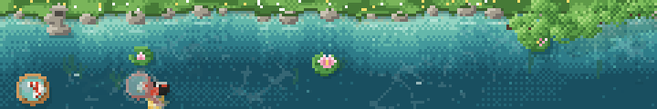

# Zen Koi

A quiet pixel-art koi pond for [bb](https://getbb.app). While your agent works,
the pond sits above the chat input and your koi swim under the text you type.



## Install

```sh
bb plugin install git:https://github.com/rejarevaldy/zen-koi.git
```

## Features

- **Watch.** Koi wander and rest. Move across the water to stir it into
  ripples, or click to scatter food.
- **Catch.** The poi moves by itself. When **!** shows, tap (or press Space) to
  scoop the koi into the bowl. After 15 seconds without a tap it plays by itself.
- **Your koi.** Draw up to nine. They grow from 15 to 45 cm over two weeks.
- **Garden and weather.** Lantern, tree, lily pads, seasons, time of day, and
  rain.
- **Sound.** Water, a wind chime, and rain. Off until you turn it on.
- **Phones.** The pond draws less often on a slow device, and you can turn it
  off on phones in the settings.

Open **Zen Pond** from the navigation rail, or the settings button on the pond,
to change any of these.

## Data

Your koi and pond settings are stored on your bb server; sound settings stay in
your browser. Nothing is sent anywhere else.

## Develop

```sh
npm install
npm test
npm run typecheck
bb plugin dev
```

Chat-input placement inspired by charpeni's
[Gone Fishing](https://github.com/charpeni/bb-plugins/tree/main/plugins/gone-fishing).

## License

MIT
