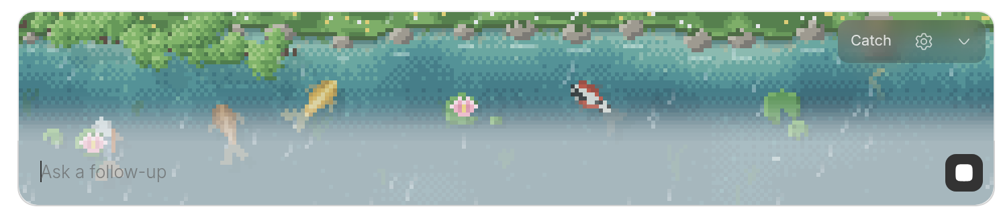
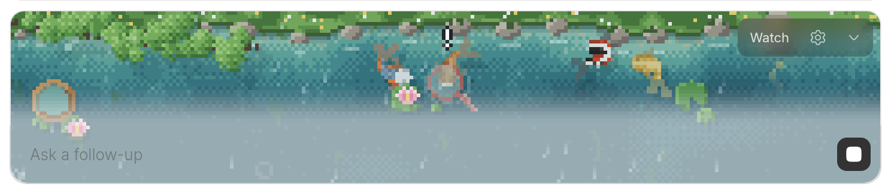
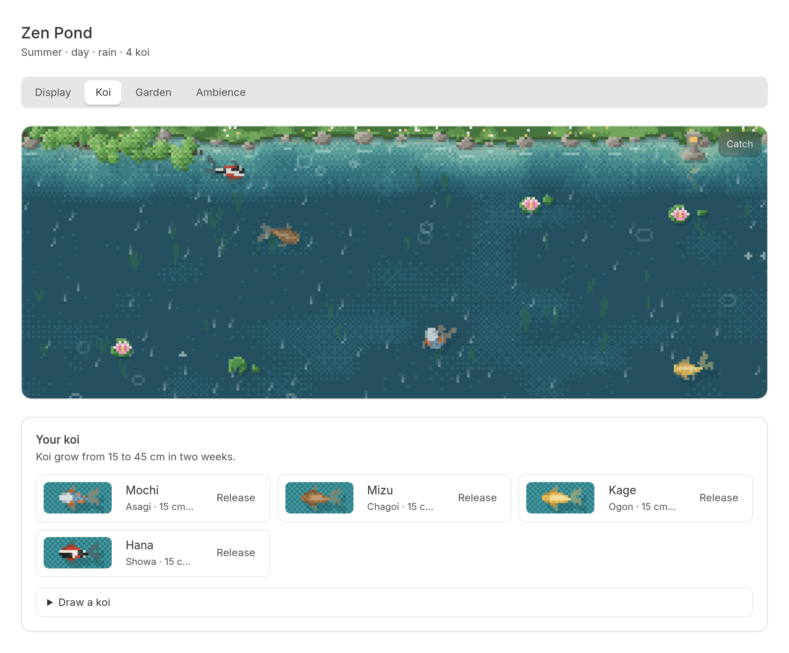

# Zen Koi

A quiet pixel-art koi pond for [bb](https://getbb.app). When an agent starts a
turn, the pond opens on top of the thread's chat input and runs on into it, so
your koi swim under the text you type. When the turn ends it settles down
again. Watch, or play a one-tap round of koi-sukui while you wait.


Zen Koi takes the chat-input placement from charpeni's
[Gone Fishing](https://github.com/charpeni/bb-plugins/tree/main/plugins/gone-fishing).
Its art and code are its own.

## Install

```sh
bb plugin install git:https://github.com/rejarevaldy/zen-koi.git
```

Or from a local checkout:

```sh
bb plugin install .
```

## Watch



Koi wander, rest, drift deeper and back up, keep each other company, and come
over to look when your pointer rests on the water. Click to scatter a little
food and the nearest koi come to eat it.

## Play koi-sukui



The festival game of scooping fish with a paper *poi*, cut down to one timing
tap so it fits a short wait.

1. The poi moves and dips by itself, and koi gather under it.
2. When a koi is right over the paper, a **!** shows. Tap the water, or press
   Space or Enter, to scoop it. Tap too soon and the koi darts off.
3. The koi rests in the floating bowl for a moment, then slips back into the
   pond.

Wet paper weakens, and a big koi strains it until it tears; a fresh poi comes a
moment later. Paper comes as No.4 (thick), No.5, or No.6 (thin). Leave it for 15
seconds and the poi scoops by itself again, so you can just watch. When the turn
ends, a small note says how many koi you caught.

Hover the pond's top-right corner, or focus it from the keyboard, for its few
controls: Catch or Watch, settings, and hide. Clicking the pond never takes
focus from the chat input.

## The Zen Pond page



Open **Zen Pond** from the navigation rail, or the settings button on the pond,
to visit any time.

- **Koi.** Draw a koi for a random variety and name, then rename it if you like.
  Keep up to nine. Koi grow from 15 to 45 cm over their first two weeks, and
  each card counts how often that koi has been scooped. A released koi swims
  off for good.
- **Display.** What the pond above the chat input shows while the agent works
  (Catch or Pond) and when it is idle (Pond or hidden), and the poi paper.
- **Garden.** A new pond layout, or a new one every day; the stone lantern, the
  overhanging tree, water plants, and lily pads.
- **Ambience.** Season and time of day (follow the calendar and clock, or pin
  them), weather, sound and volume, and a breathing guide.

## The garden and the weather

- A shoreline of grass and mossy stones, water that deepens away from the bank,
  sunlight drifting over the bed, and water plants swaying.
- A tree that follows the season: sakura in spring, green in summer, maple red
  in autumn, bare with snow in winter. Petals and leaves fall and float away;
  fireflies come out on summer evenings.
- A stone lantern lit from dusk to dawn and in the rain. The moon shows on
  clear nights.
- Rain that drifts between a drizzle and a steady shower: thin slanted streaks,
  rings on the water, a soft patter, and the odd drip.
- Sound, off until you turn it on: moving water, a wind chime in the
  miyako-bushi scale, the odd knock of a shishi-odoshi, and rain, in a soft
  reverb.
- A breathing guide (in for 4, hold for 2, out for 6), with a slow ring across
  the pond on every in-breath.

## Data

Your koi, garden, and ambience are saved in the plugin's key-value storage on
the bb server, along with how often each koi has been scooped, so they follow
you between the desktop app and the browser. Sound settings and whether the
pond is hidden stay on this device. Nothing leaves your bb server.

## Performance

The pond redraws 25 times a second while you can see it, and rests when the
tab is hidden or the pond is scrolled out of view. Slow light on the water is
redrawn about ten times a second and shared by the strip and the chat input.
With reduced motion, the pond holds still and redraws twice a second.

bb has no plugin API for placing UI next to the chat input. Zen Koi finds the
chat input through bb's markup (`[data-app-composer]`,
`[data-follow-up-composer-anchor]`, `form[data-promptbox]`). If a bb update
changes that markup, the pond falls back to bb's banner position and the chat
input stays dry.

## Develop

```sh
npm install
npm test          # simulation, koi-sukui, and storage tests (node:test)
npm run typecheck
bb plugin build
bb plugin dev     # rebuild and reload on save
```

| File                | What it does                                               |
| ------------------- | ---------------------------------------------------------- |
| `config.ts`         | The saved pond: koi, garden, ambience, and defaults         |
| `koi.ts`            | The simulation: koi, food, ripples, rain, falling petals    |
| `sukui.ts`          | Koi-sukui: the poi, the paper, the bowl, and auto play      |
| `scene.ts`          | The pixel-art painter, one pond world per set of canvases   |
| `world.ts`          | Ties the config, simulation, painter, and poi together      |
| `composer-water.ts` | The pond's continuation behind the chat input               |
| `sound.ts`          | The soundscape, made with Web Audio                         |
| `app.tsx`           | The pond above the chat input and the Zen Pond page         |
| `server.ts`         | Stores the pond and scoop counts                            |

## License

MIT
